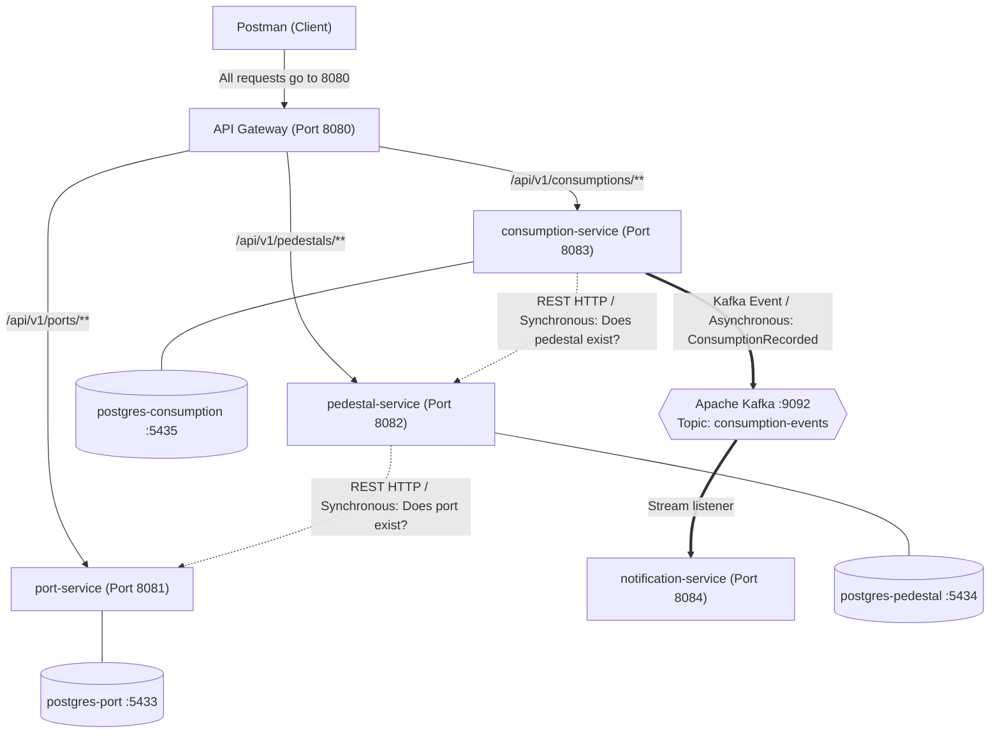

# 🛥️ SMART MARINA — Complete Beginner's Guide (Weeks 1 to 6)

Welcome to the complete story of your **Smart Marina** project! This guide explains everything you built, why you built it, how each piece works, and what all the tools do — written in **plain, simple language with zero complicated jargon**.

---

## 🧭 Table of Contents
1. [The Big Picture: What is Smart Marina?](#1-the-big-picture-what-is-smart-marina)
2. [The Tools We Use & What They Actually Do](#2-the-tools-we-use--what-they-actually-do)
   - [What is Spring Boot?](#what-is-spring-boot)
   - [What is Docker & What is Inside It?](#what-is-docker--what-is-inside-it)
   - [What is Postman?](#what-is-postman)
   - [What is Git & GitHub?](#what-is-git--github)
   - [What is Apache Kafka?](#what-is-apache-kafka)
3. [The Microservice Architecture](#3-the-microservice-architecture)
4. [Inside a Microservice: The 5 Layers (Controller, Service, etc.)](#4-inside-a-microservice-the-5-layers)
5. [Week by Week: What We Built and How It Works](#5-week-by-week-what-we-built)
   - [Week 1: Setup & Tools](#week-1-setup--foundations)
   - [Week 2: port-service (Managing Ports)](#week-2-port-service)
   - [Week 3: pedestal-service & RestClient (Managing Bornes)](#week-3-pedestal-service--restclient)
   - [Week 4: API Gateway (One Single Front Door)](#week-4-api-gateway)
   - [Week 5: consumption-service (Recording Electricity & Water)](#week-5-consumption-service)
   - [Week 6: Kafka & notification-service (Event-Driven Alerts)](#week-6-kafka--notification-service)
6. [Synchronous vs Asynchronous Communication (The Golden Rule)](#6-synchronous-vs-asynchronous-communication)
7. [Defense Cheat Sheet: Questions You Will Be Asked](#7-defense-cheat-sheet)

---

## 1. The Big Picture: What is Smart Marina?

Imagine a modern seaport or marina where hundreds of yachts and boats dock.
In the old days, marina workers wrote everything on paper: which boat is at which dock, how much electricity they plugged into, and how much water they used.

**Smart Marina** is a software system that automates all of this:
- **Ports (`port-service`)**: Keeps track of harbors and marinas (e.g., Port de Sidi Bou Said).
- **Pedestals / Bornes (`pedestal-service`)**: The physical utility pillars on the pontoon where boats plug in electricity and water.
- **Consumption (`consumption-service`)**: Records how many kilowatt-hours (kWh) of electricity or cubic meters ($m^3$) of water a boat used.
- **Notifications (`notification-service`)**: Instantly alerts managers if a boat is consuming too much electricity or if something is wrong.
- **API Gateway (`api-gateway`)**: The front reception desk. External clients only talk to one address, and the gateway forwards requests to the right service.

Instead of putting all of this code into one gigantic monster program (called a **Monolith**), we split it into **Microservices** — small, independent programs that do one specific job really well.

---

## 2. The Tools We Use & What They Actually Do

### What is Spring Boot?
Think of Java as plain Lego bricks, and **Spring Boot** as a motorized Lego set with pre-built engines and wheels.
- Without Spring Boot, setting up a web server, connecting to a database, and handling JSON takes thousands of lines of setup code.
- With Spring Boot, you add a few annotations like `@RestController` or `@Service`, and Spring handles the rest automatically. It even includes a built-in web server (**Tomcat** or **Netty**) so you can just click Play and your app is immediately live on the web!

### What is Docker & What is Inside It?
Imagine you want to run PostgreSQL (a database) and Kafka (a message broker) on your computer. Normally, you'd have to download 2 heavy installers, configure Windows services, deal with registry keys, and pray they don't break each other.

**Docker** solves this by using **Containers**. A container is like an isolated mini-computer running inside your PC with just the software you need. When you want to delete it or restart it, it takes 2 seconds and leaves zero mess on your Windows machine.

#### What is running inside YOUR Docker Desktop?
In `infra/docker-compose.yml`, you configured 4 separate containers:

```
┌─────────────────────────────────────────────────────────────┐
│                       DOCKER DESKTOP                        │
│                                                             │
│  [ postgres-port ]         ──► Port 5433 (Database for ports)│
│  [ postgres-pedestal ]     ──► Port 5434 (Database for pedestals)
│  [ postgres-consumption ]  ──► Port 5435 (Database for readings)
│  [ kafka ]                 ──► Port 9092 (Message broker)   │
└─────────────────────────────────────────────────────────────┘
```

1. **`postgres-port` (port 5433):** The private database for `port-service`.
2. **`postgres-pedestal` (port 5434):** The private database for `pedestal-service`.
3. **`postgres-consumption` (port 5435):** The private database for `consumption-service`.
4. **`kafka` (port 9092):** The Apache Kafka message broker that passes real-time messages between services.

> **Crucial Rule:** Notice that every microservice has its **own separate database container and port**. A service is **never allowed** to touch another service's database!

### What is Postman?
When you build a backend with Spring Boot, there is no visual website or buttons yet — it only responds to HTTP requests using JSON.
**Postman** is a tool that acts as your test client. It lets you send:
- `GET` (Fetch data)
- `POST` (Create new data)
- `PUT` (Update data)
- `DELETE` (Remove data)

You type a URL like `http://localhost:8080/api/v1/ports`, click **Send**, and Postman shows you the server's reply and status code (`200 OK`, `201 Created`, `400 Bad Request`, `404 Not Found`, `500 Error`).

### What is Git & GitHub?
- **Git** is the time machine on your laptop. Every time you make progress, you create a "save point" (`git commit`). If you break something later, you can travel back in time.
- **GitHub** is the cloud backup. When you type `git push`, your code is uploaded to the internet so you never lose your project and your teacher can review it.

### What is Apache Kafka?
Imagine a bulletin board or a post office.
- A service can pin a note to the board: *"Pedestal #3 just consumed 75 kWh!"* (This service is called a **Producer**).
- Another service reads the notes on the board: *"Oh! 75 kWh is high, let me send an alert!"* (This service is called a **Consumer**).
- The bulletin board itself is **Kafka**.
- The specific topic or section of the board is called a **Topic** (`consumption-events`).

The best part? The producer pins the note and walks away immediately. It doesn't care if the consumer is reading it right now, sleeping, or busy. Kafka holds onto the note safely.

---

## 3. The Microservice Architecture

Here is the complete map of how your system communicates:



---

## 4. Inside a Microservice: The 5 Layers

Every Spring Boot microservice you built follows the exact same clean, professional architecture:

| Layer | File Example | What it does in simple words |
|---|---|---|
| **Entity** | `Port.java` | Maps directly to a table in PostgreSQL. Fields = table columns. |
| **DTO** | `PortRequest.java`, `PortResponse.java` | "Data Transfer Object". The bodyguard. It filters what data is allowed in and out, with validations (`@NotBlank`, `@NotNull`, `@Positive`). |
| **Repository** | `PortRepository.java` | Talks directly to PostgreSQL. Spring writes all SQL queries (`SELECT`, `INSERT`, `UPDATE`, `DELETE`) for you automatically! |
| **Service** | `PortService.java` | The brain. Contains business rules (e.g. checking if a port code is already taken, checking if another service is alive). |
| **Controller** | `PortController.java` | The receptionist. Listens for HTTP requests (`@GetMapping`, `@PostMapping`), calls the Service, and returns JSON. |
| **Client** | `PortClient.java` | The phone. Used when this service needs to call another service via HTTP (`RestClient`). |

---

## 5. Week by Week: What We Built

### Week 1: Setup & Foundations
- **Goal:** Set up Java 21, Maven, Git, Docker Desktop, IntelliJ, and Postman.
- **Outcome:** Created the project repository and verified all tools were ready to build microservices.

---

### Week 2: `port-service` (Port 8081)
- **Goal:** Build the first complete microservice with its own database.
- **What it does:** Manages ports/harbors (create, list, find by ID, update, delete).
- **Key concepts learned:**
  - Entity: `Port` (`code`, `name`, `city`, `country`).
  - DTOs to protect data and validate inputs.
  - Spring Data JPA to automatically save records into `postgres-port` on port 5433.
- **Postman Tests:**
  - `POST /api/v1/ports` with code `"TN5BS"` ➔ `201 Created`.
  - Duplicate code ➔ `409 Conflict`.
  - Invalid data (empty name) ➔ `400 Bad Request`.

---

### Week 3: `pedestal-service` & RestClient (Port 8082)
- **Goal:** Build the second microservice and make it talk to the first microservice!
- **What it does:** Manages pedestals (bornes) on the docks. Each pedestal must belong to a valid Port.
- **The Challenge:** How does `pedestal-service` know if Port #1 actually exists without touching Port's database?
- **The Solution (`RestClient`):**
  - Inside `pedestal-service`, we wrote `PortClient.java`.
  - When you try to create a pedestal with `portId: 1`, `pedestal-service` calls `http://localhost:8081/api/v1/ports/1`.
  - If `port-service` says **200 OK**, the pedestal is saved (`201 Created`).
  - If `port-service` says **404 Not Found**, the pedestal is rejected with **`400 Bad Request`** ("Port introuvable").
  - If `port-service` is **stopped/crashed**, the pedestal service answers **`503 Service Unavailable`** ("Port service is not available").

---

### Week 4: API Gateway (Port 8080)
- **Goal:** Create one single front entrance for all services.
- **Why?** Before Week 4, Postman had to remember port 8081 for ports and port 8082 for pedestals. In a real system with 50 microservices, clients cannot manage 50 different IP addresses and ports!
- **What it does:**
  - Built with **Spring Cloud Gateway (Reactive / WebFlux)** on port **8080**.
  - Has zero Java business code — **pure configuration in `application.yml`**.
  - Routes requests:
    - `/api/v1/ports/**` ➔ forwards to `http://localhost:8081`
    - `/api/v1/pedestals/**` ➔ forwards to `http://localhost:8082`
    - `/api/v1/consumptions/**` ➔ forwards to `http://localhost:8083`
  - Added filter: adds the header **`X-Gateway: smart-marina-gateway`** to every response.
- **Proof & Resilience:**
  - Direct call to 8081: No `X-Gateway` header.
  - Gateway call to 8080: Has `X-Gateway` header.
  - Stopping `pedestal-service`: Port calls still work with `200 OK`! Proves that one service crashing does not bring down the entire marina.

---

### Week 5: `consumption-service` (Port 8083)
- **Goal:** Record water and electricity usage for pedestals.
- **What it does:**
  - Connected to its own database `postgres-consumption` on port **5435**.
  - Has an entity `Consumption` with `pedestalId`, `type` (`ELECTRICITY` or `WATER`), `value`, `unit` (`kWh` or `m3`), and `recordedAt`.
  - Uses `PedestalClient` to verify that the pedestal exists before saving a reading.
  - Routes through the gateway at `http://localhost:8080/api/v1/consumptions`.

---

### Week 6: Kafka & `notification-service` (Port 8084)
- **Goal:** Implement an **Event-Driven Architecture (EDA)** with **Apache Kafka**.
- **What it does:**
  1. `consumption-service` acts as a **Kafka Producer**:
     - Whenever a consumption reading is saved, it publishes an event `ConsumptionEvent` to Kafka on topic `consumption-events`.
     - It uses `pedestalId` as the message key to keep readings in perfect chronological order on Kafka partitions.
  2. `notification-service` acts as a **Kafka Consumer**:
     - Listens to the `consumption-events` topic using `@KafkaListener`.
     - When an event arrives, it logs a notification in real-time.
     - **Business Rule:** If electricity consumption is higher than 50 kWh, it immediately raises a `[ALERT] High consumption detected` warning!

---

## 6. Synchronous vs Asynchronous Communication

This is the most important theoretical concept in your entire project:

| Concept | Synchronous (REST / HTTP) | Asynchronous (Kafka / Events) |
|---|---|---|
| **Real-life analogy** | A phone call: both people must be on the line at the exact same second. | A letter in a mailbox: you drop it off and continue your day; the other person reads it when ready. |
| **Smart Marina Example** | `pedestal-service` calls `port-service`: *"Does Port 1 exist?"* It **must** have the answer right now to decide whether to save the pedestal. | `consumption-service` tells Kafka: *"Borne 3 just recorded 75 kWh."* It saves and returns immediately; `notification-service` reads it whenever it's ready. |
| **If the other service is down** | Call fails (`503 Service Unavailable`). | Message waits safely in Kafka. When the service restarts, it reads the message without any data loss! |
| **Coupling** | **Tight coupling** (must know URL, port, and be online). | **Loose coupling** (producer only knows the Kafka topic name). |

---

## 7. Defense Cheat Sheet: Questions You Will Be Asked

### Q1: Why use Microservices instead of a Monolith?
> **Answer:** In a monolith, everything is in one project. If the notification code crashes, the whole harbor shuts down. With microservices:
> 1. Each service is independent: if `notification-service` crashes, `port-service` and `pedestal-service` continue working normally.
> 2. Each service can scale on its own (e.g. run 5 instances of consumption during peak summer season).
> 3. Different teams can work on different services without stepping on each other's toes.

### Q2: Why does every microservice have its own database?
> **Answer:** This is called the **Database-per-Service** pattern. It guarantees **loose coupling**. If all services shared one database:
> - A change to the `ports` table could break `pedestal-service`.
> - If the database crashes, all microservices die simultaneously.
> - Services must talk through clean REST APIs or Kafka events, never by peeking into another service's private tables.

### Q3: What is the role of the API Gateway? What must it NOT do?
> **Answer:**
> - **Role:** It is the single entry door for all external clients (Postman, mobile apps, web dashboards). It handles routing, adds security headers, and simplifies client access so clients don't need to know dozens of internal ports.
> - **What it must NOT do:** It must **never contain business logic**! Calculations, database validations, and business rules belong exclusively inside the microservices.

### Q4: What is the difference between REST and Kafka? When do you choose which?
> **Answer (The Golden Rule):**
> - If I **need the response immediately** to continue my work ➔ Use **REST (Synchronous)**. (Example: checking if a port exists before saving a pedestal).
> - If I only need to **announce that a fact occurred** without waiting ➔ Use **Kafka (Asynchronous)**. (Example: announcing that a consumption reading was taken).

### Q5: Why did we use `pedestalId` as the Kafka message key?
> **Answer:** Kafka distributes messages across partitions. Messages with the **same key always go to the same partition**. This guarantees that all readings for Borne #3 are processed in the **exact chronological order** they occurred.

---

## 8. Summary of Ports & Services in Your Project

| Service | Port | Database / Broker | Role |
|---|---|---|---|
| **api-gateway** | `8080` | None | Single entry point, routes traffic |
| **port-service** | `8081` | PostgreSQL (`5433: portdb`) | Manages ports / marinas |
| **pedestal-service** | `8082` | PostgreSQL (`5434: pedestaldb`) | Manages bornes / pedestals |
| **consumption-service** | `8083` | PostgreSQL (`5435: consumptiondb`) | Records kWh and $m^3$, emits Kafka events |
| **notification-service** | `8084` | None (Kafka Consumer) | Listens to Kafka and raises alerts |
| **Apache Kafka** | `9092` | Docker container `kafka` | Message broker for asynchronous events |
